# 香里園 交通情報サイネージ 仕様書

学校から京阪香里園駅へ向かう人のために、京阪電車の発車予定、京阪バスの接近情報、
関西の鉄道各社の運行情報を1枚の画面にまとめて表示するデジタルサイネージです。
物理部が開発・運用しています。
京阪電車・京阪バス・鉄道各社とは関係のない非公式のもので、各社が提供・確認したものではありません。

この文書は、サイネージが「何を、どの情報をもとに、どう表示するか」をまとめた仕様書です。
特に、列車が遅れたときや止まったときの表示を詳しく説明します。
開発・保守の手順は [docs/DEVELOPMENT.md](docs/DEVELOPMENT.md) にあります。

画面の画像は、断りがない限りデモ機能で作った架空の場面です。実際の運行記録ではありません。

## 目次

1. [目的](#1-目的)
2. [通常時の画面](#2-通常時の画面)
3. [表示する情報と取得元](#3-表示する情報と取得元)
4. [遅延時の挙動](#4-遅延時の挙動)
5. [情報が取れないときの挙動](#5-情報が取れないときの挙動)
6. [時計の表示と切り替えの予定](#6-時計の表示と切り替えの予定)
7. [個人情報と安全面](#7-個人情報と安全面)
8. [既知の制限](#8-既知の制限)
9. [システム構成](#9-システム構成)
10. [デモ](#10-デモ)

## 1. 目的

学校から香里園駅までは歩いて約25分かかります。駅に着くころには状況が変わっているので、
駅の発車標をそのまま写すだけでは役に立ちません。このサイネージは、次の判断に使える情報を出すことを目的にしています。

- いま学校を出れば、どの列車に乗れそうか
- 列車が遅れているか、止まっているか、それは京都方面と大阪方面のどちらか
- 電車の代わりにバスを使えるか
- 乗り換え先の路線（JR・大阪メトロ・私鉄）は動いているか

## 2. 通常時の画面

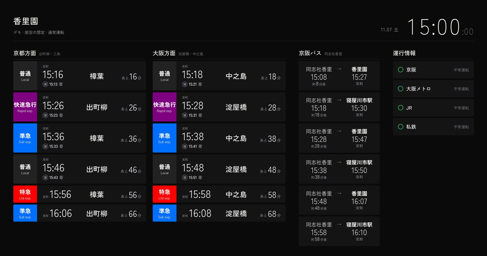

画面は左から4つの欄に分かれています。

| 欄 | 内容 |
|---|---|
| 京都方面 | 香里園駅から京都方面（出町柳・三条方面）へ向かう列車。最大6本 |
| 大阪方面 | 香里園駅から大阪方面（淀屋橋・中之島方面）へ向かう列車。最大6本 |
| 京阪バス | 「同志社香里」バス停に来るバス。最大6本 |
| 運行情報 | 京阪・大阪メトロ・JR・私鉄の4つに分けた運行状況 |

上部には駅名、日付、時刻を表示します。時刻はインターネット上の時刻サーバー（NTP）に合わせています。

### 列車の欄

1本の列車を1枚のカードで表示します。

| 位置 | 内容 |
|---|---|
| 左端の色つきの枠 | 種別（普通・準急・急行・快速急行・特急など）と英語表記 |
| 中央左 | 香里園駅の発車時刻 |
| 時刻の下 | 寝屋川市駅（「寝」の丸印）に着く時刻 |
| 中央 | 行き先 |
| 右端 | 香里園駅に着くまでの残り時間（「あと16分」） |

- 発車案内には、香里園駅に着くまで15分以上ある列車だけを出します。15分未満の列車と、いま香里園駅に止まっている列車は出しません。
  ただし、推定の時刻を出せない列車（4.4）は、残り時間が分からないので、この条件にかかわらず表示します。
- 各方面の先頭4本は大きいカード、5本目以降は小さいカードで表示し、小さいカードでは寝屋川市駅の時刻を省きます。

### バスの欄

左に「同志社香里」バス停に来る予定時刻と残り時間、右に行き先と終点に着く時刻を表示します。
バス停に来る時刻は京阪バスの接近情報による予測です。終点の時刻は時刻表どおりの時刻で、遅れは足していません。

### 運行情報の欄

各社の公式サイトに出ている運行情報を、京阪・大阪メトロ・JR・私鉄の4つに分けて表示します。

| 印 | 意味 |
|---|---|
| ○ | 平常運転（影響のある路線がない） |
| △ | 列車遅延・部分運休などがある |
| × | 運転見合わせの路線がある |
| − | 情報を取得できていない |

影響のある路線があるときは、その路線名と状態を欄の中に表示し、画面の下部に各社の発表文を表示します。
影響のある路線が多いときは、4秒（欄の中）または6秒（下部）ごとに表示を切り替えます。
発表文の右には、その発表から何分たったかを表示します。

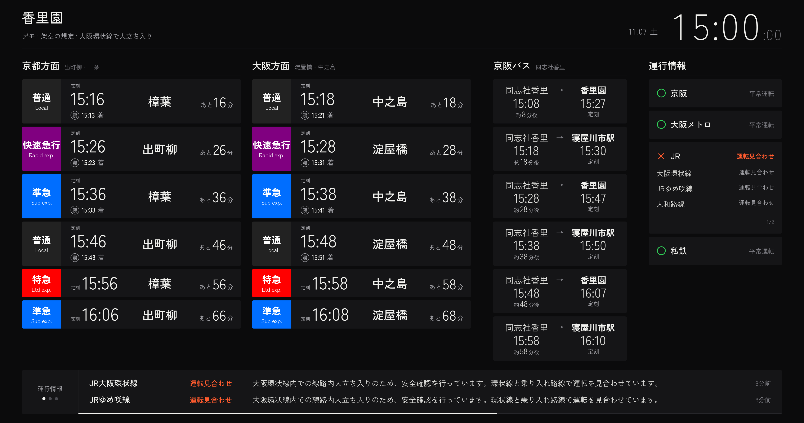

上の画像は、JR大阪環状線が止まり、京阪は平常運転という想定です。京阪の列車の欄は通常どおりで、
JRの欄と画面下部に見合わせの情報が出ます。

## 3. 表示する情報と取得元

| 情報 | 取得元 | 更新の間隔 |
|---|---|---|
| 京阪電車の列車の位置・遅れ | 京阪電車公式サイトの列車走行位置 | 1分ごと |
| 京阪電車の時刻表 | 京阪電車公式サイトの時刻表 | 1時間ごと |
| 京阪バスの接近情報・時刻表 | 京阪バス公式のバス接近情報（バスナビ） | 1分ごと |
| 鉄道各社の運行情報 | 各社の公式サイト | 10分ごと |

取得には、物理部が作成した2つのライブラリを使います。

- [keihan_tracker](https://github.com/dk-butsuri/keihan_tracker)：京阪電車の列車位置・時刻表と京阪バスの情報
- [train_operation_info](https://github.com/dk-butsuri/train_operation_info)：鉄道各社の運行情報

「遅れ」の分数は京阪電車の公式発表の値です。一方、画面に出る「推定」の時刻と「あと何分」は、
公式の値をもとにこのシステムが計算したものです。鉄道会社が発表した到着予定ではありません。

## 4. 遅延時の挙動

### 4.1 この章で使う言葉

| 言葉 | 意味 |
|---|---|
| 定刻 | 時刻表に書かれている、香里園駅の発車時刻 |
| 遅れ | 京阪電車の公式サイトが列車ごとに出している「何分遅れ」の値 |
| 推定 | 定刻に遅れを足し、遅れが10分以下なら香里園駅までの残り時間に応じて割り引いた時刻。このシステムが計算する（4.3） |
| あと何分 | 推定の時刻までの残り時間 |

### 4.2 遅れが小さいとき

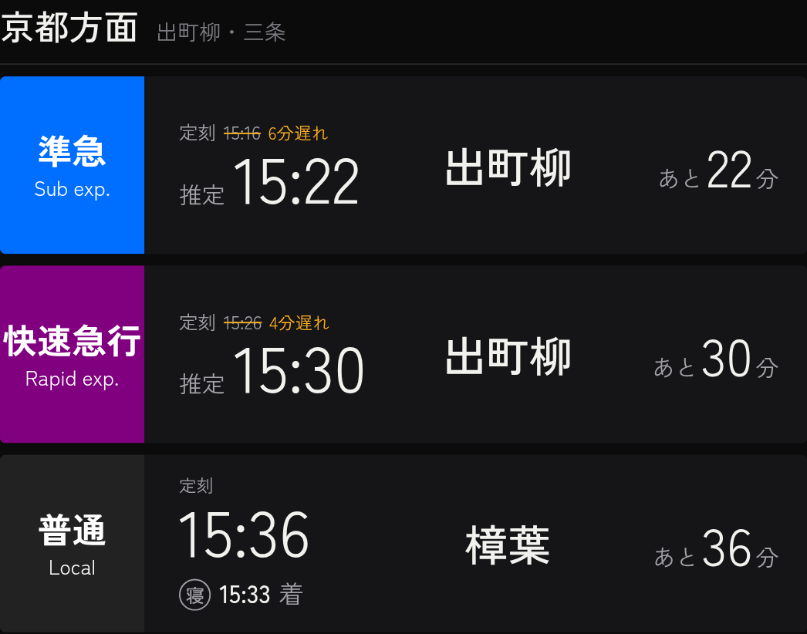

遅れがある列車は、カードの表示が次のように変わります。

- 上の小さい文字に、定刻を取り消し線つきで残し、横に「6分遅れ」のように遅れを表示します。
- 大きい文字は「推定」の時刻になります（求め方は 4.3）。
- 右端の「あと何分」も、推定の時刻までの残り時間です。
- 寝屋川市駅の時刻は表示しません。
- 遅れがない列車（上の画像の3本目）は、これまでどおり定刻と寝屋川市駅の時刻を表示します。

### 4.3 推定の時刻を出す条件

遅れの値は、列車が香里園駅に近づくまでの間に増えたり減ったりします。
香里園駅から遠くにいる列車ほど、また遅れが大きい列車ほど、計算した推定の時刻は外れやすくなります。
そこで、香里園駅に着くまでの残り時間（推定）と遅れの大きさの組み合わせで、推定の時刻を出すかどうかを決めています。

遅れていない列車（遅れ0分）は、残り時間にかかわらず定刻と「あと何分」を表示します。
ただし、4.4・4.5 に当てはまる列車は「推定 未定」にします。

遅れている列車は、次の2つの条件のどちらかを満たせば、推定の時刻と「あと何分」を表示します。
ここでの残り時間は、定刻に遅れをそのまま足した時刻までの時間です。

| 香里園駅までの残り時間 | 遅れ |
|---|---|
| 60分以内 | 10分以内 |
| 25分以内 | 60分以内 |

例：

- 残り50分・遅れ8分の列車：1行目を満たすので、推定の時刻を出します。
- 残り30分・遅れ15分の列車：どちらの行も満たさないので、推定の時刻を出しません。
  残り25分以内になった時点で2行目を満たし、推定の時刻を出します。

遅れが10分以下の列車は、香里園駅に着くまでに遅れが縮まることが多いので、推定の時刻を次の式で求めます。
残り時間を H 分、遅れを D 分とします。

推定の時刻 ＝ 定刻 ＋ D − min(D, 0.1×H)（分単位に丸める）

たとえば、残り30分・遅れ6分の列車は、6 − 3 ＝ 3分を定刻に足します。残り60分なら割り引きが6分になり、推定の時刻は定刻と同じになります。
遅れが10分を超える列車は、遅れをそのまま足します。「あと何分」は、この推定の時刻までの残り時間です。

どの条件も満たさない列車は、カードの時刻を「推定 未定」とし、代わりに列車がいまどこにいるかを表示します（4.4 と同じ表示です）。

### 4.4 推定の時刻を出さない列車

次のどれかに当てはまる列車は、残り時間にかかわらず推定の時刻を出しません。
どれも「列車がほとんど進んでいない」と判断できる場合です。

1. **遅れが増え続けている列車**
   5分前と比べて、遅れが経過時間の0.7倍以上増えている列車です。
   たとえば5分間で遅れが3.5分以上増えていれば、この列車はほぼ止まっていると判断します。
   このような列車では、遅れの値をもとにした推定の時刻がすぐに古くなるためです。
2. **遅れが2時間以上の列車**（4.6 を参照）
3. **同じ場所に15分より長くとどまっている列車**
   始発駅で発車を待っている列車は除きます。
   1の判定には5分間の記録が必要なので、サイネージを起動した直後はこの条件で止まっている列車を見分けます。
4. **前が詰まっている列車**
   同じ方面で、その列車と香里園駅の間にいる列車のうち1本でも、1か3に当てはまる列車です。
   前の列車を追い越せないので、その列車自身が動いていても、前の列車が動くまで到着時刻を決められないためです。
   種別は問いません。同じ位置にいる列車と、香里園駅を過ぎた列車は数えません。香里園駅に止まっている列車は数えます。
   遅れが2時間以上というだけの列車（2）は、遅れの値が頭打ちなだけで進んでいないとは限らないので、ここでは数えません。
   対象は京阪本線・鴨東線・中之島線を走る列車です。

これらの列車のカードは次のように表示します。

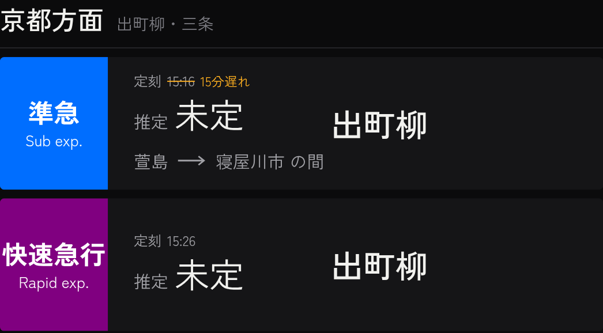

- 時刻の欄は「推定 未定」とし、上の小さい文字に定刻と遅れを残します。
- 時刻の下に、列車がいまいる場所を表示します。駅と駅の間にいるときは「萱島 → 寝屋川市 の間」、
  駅にいるときは「寝屋川市 停車中」のように表示します。
- 同じ場所に5分以上とどまっていれば、右端に「17分停止」のように止まっている時間を表示します。

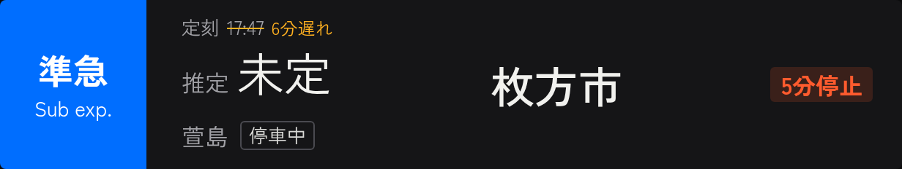

止まっている時間の後ろに「以上」が付くことがあります（例：「25分以上停止」）。
これは、サイネージを起動した時点ですでにその場所にいたため、それより前から止まっていた時間が分からないことを表します。

### 4.5 後に続く列車の扱い

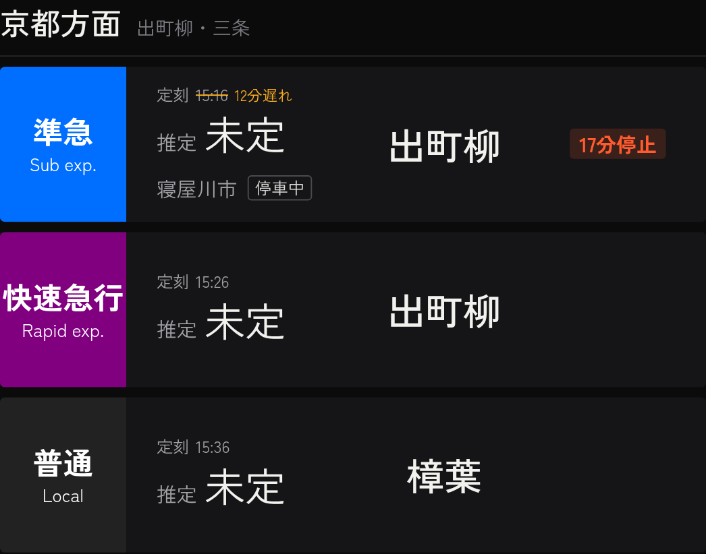

同じ方面で、定刻がいちばん早い列車の推定の時刻を出せないときは、その後に続く列車のうち、
まだ始発駅を出ていない列車の推定の時刻も出しません。カードの時刻はすべて「推定 未定」になります。

後に続く列車は、前の列車を追い越して先に着くことができません。前の列車が止まっている間は、
後に続く列車の到着時刻も決められないためです。
上の画像では、先頭の準急が寝屋川市駅で17分止まっているので、後の快速急行と普通も「推定 未定」になっています。

時刻表どおりの時刻（定刻）は、参考として小さい文字で残します。

### 4.6 遅れが2時間を超えたとき

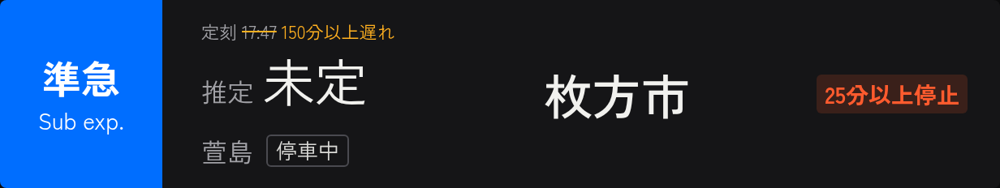

京阪電車の公式サイトは、遅れが2時間を超えると分数を出さず「2時間以上」とだけ表示します。
このときサイネージは、keihan_tracker が時刻表上の予定時刻と現在の時刻から計算した「少なくともこれだけは遅れている」という分数を使い、
「150分以上遅れ」のように表示します。この値は下限なので、推定の時刻は出しません。
下限を計算できないときは「2時間以上遅れ」と表示します。

### 4.7 カードの表示の一覧

列車のカードは、次の3つの組み合わせで表示が決まります。

- 推定の時刻を出せるか（4.3・4.4）
- 遅れがあるか
- 同じ場所に5分以上止まっているか

| 推定 | 遅れ | 停止 | 表示 |
|---|---|---|---|
| 出せる | なし | なし | 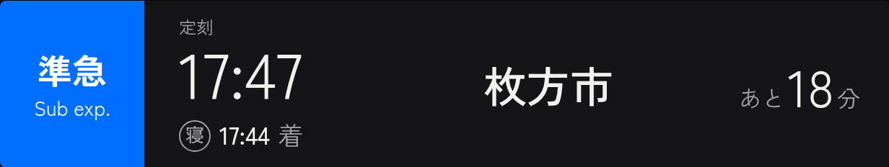 |
| 出せる | あり | なし | 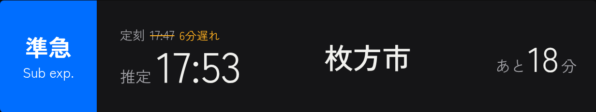 |
| 出せない | なし | なし |  |
| 出せない | あり | なし |  |
| 出せない | なし | あり | 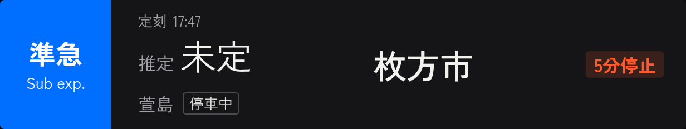 |
| 出せない | あり | あり |  |

推定の時刻を出せる列車では、止まっている時間を表示しません。このような列車は、止まっていても15分以内で、遅れも増え続けていないので、推定の時刻を優先して表示します。

この一覧は、サイネージの `/demo/display-patterns` で実際の描画処理を使って確認できます。

### 4.8 見合わせ時の画面への切り替え

京阪本線で多くの列車が止まると、画面全体を「見合わせ時の画面」に切り替えます。

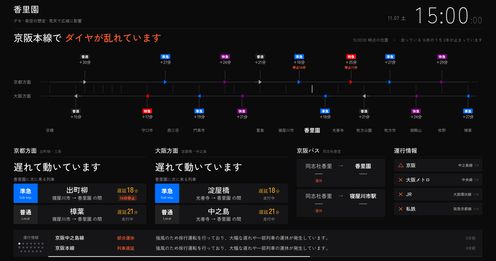

**切り替える条件**（次のどちらか）

- 京橋〜樟葉の間を走っている京阪本線の列車のうち、推定の時刻を出せない列車（4.4 に当てはまる列車）が
  25%以上の状態が、2回続けて（約2分間）確認された。
- 京阪電車の公式の運行情報に「運転見合わせ」が出た。この場合はすぐに切り替えます。

**通常の画面に戻す条件**（次のすべて）

- 公式の運行情報に「運転見合わせ」が出ていない。
- 推定の時刻を出せない列車の割合が15%未満の状態が、5分間続いた。

切り替える基準（25%）と戻す基準（15%）を変えているのは、割合が境目の前後で上下したときに、
画面が何度も切り替わるのを防ぐためです。
列車の位置を取得できていないときや、対象の列車が1本もないときは、それまでの画面のまま変えません。

### 4.9 見合わせ時の画面の読み方

**上段：路線図**

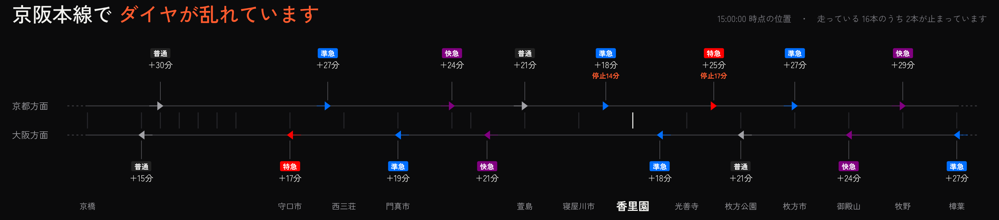

- 京橋から樟葉までの京阪本線を横線で表し、上の線が京都方面、下の線が大阪方面の列車です。香里園駅には縦の印を付けています。
- 三角の印が1本の列車で、印の位置が列車のいる場所です。印の色は種別を表します。
- 印の上（京都方面）または下（大阪方面）に、種別、遅れ（「+18分」）、止まっている時間（「停止14分」）を表示します。
- 見出しの右に、位置の情報の時刻と「走っている16本のうち2本が止まっています」のような集計を表示します。
  この「止まっている」は、4.4 に当てはまり、かつ同じ場所に5分以上いる列車の数です。
- 野江〜土居、古川橋〜大和田の区間は、画面に収めるために駅名を省いて間隔を詰めています。
- 京橋より大阪側と樟葉より京都側にいる列車は路線図に出しませんが、集計と方面ごとの判定には含めます。

**中段：方面ごとの状態**

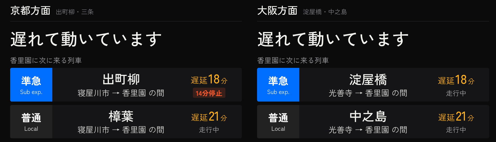

京都方面・大阪方面それぞれについて、香里園駅にこれから来る列車（始発駅で待っている列車は除く）を見て、
次の順に判定します。

| 表示 | 条件 |
|---|---|
| 止まっています | すべての列車が、同じ場所に10分以上いる |
| 多くの列車が止まっています | 半数以上の列車が、同じ場所に10分以上いる |
| 遅れて動いています | 次に来る列車の遅れが5分以上 |
| 動いています | 上のどれにも当てはまらない |
| 香里園に向かう列車の情報がありません | 対象の列車が1本もない |

その下に、香里園駅に次に来る列車を方面ごとに2本、いまいる場所と遅れ、止まっている時間つきで表示します。

**京阪本線がすべて止まっている場合**

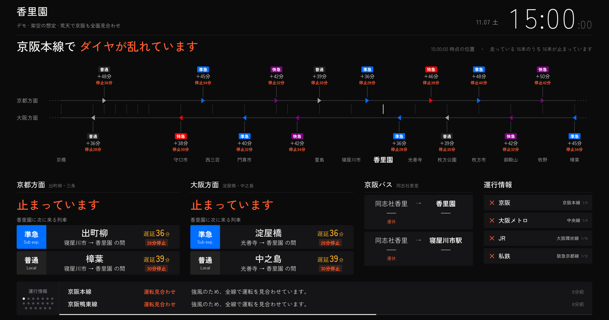

すべての列車が止まると、両方面とも「止まっています」になり、路線図のすべての列車に止まっている時間が付きます。

**右側と下部**

見合わせ時の画面でも、バスの欄（最大4本）と運行情報の欄を表示します。運行情報は下部にも表示を続けます。

## 5. 情報が取れないときの挙動

外部のサイトから情報を取得できないときに、古い情報を新しい情報のように見せないことを優先しています。

| 状況 | 表示 |
|---|---|
| 列車の位置を5分より長く取得できていない | 列車の表示を止め、「列車位置を取得できていないため表示を止めています（14:05時点の情報）」のように理由を表示する |
| 取得はできているが、位置の情報が5分より古く、走っている列車が残っている | 列車の表示を止め、「列車位置の情報が古いため表示を止めています」と表示する |
| バスの情報を取得できない | 前回取得できた一覧を表示し続ける |
| 一部の鉄道会社の運行情報を取得できない | その会社だけ前回の情報を使い、他社は最新の情報を表示する。一度も取得できていなければ「情報なし」 |

終電の後（0時45分ごろ以降）は公式の位置情報が更新されなくなりますが、走っている列車が0本になるので、表示は止めません。

**サイネージの端末とサーバーの通信が途切れたとき**

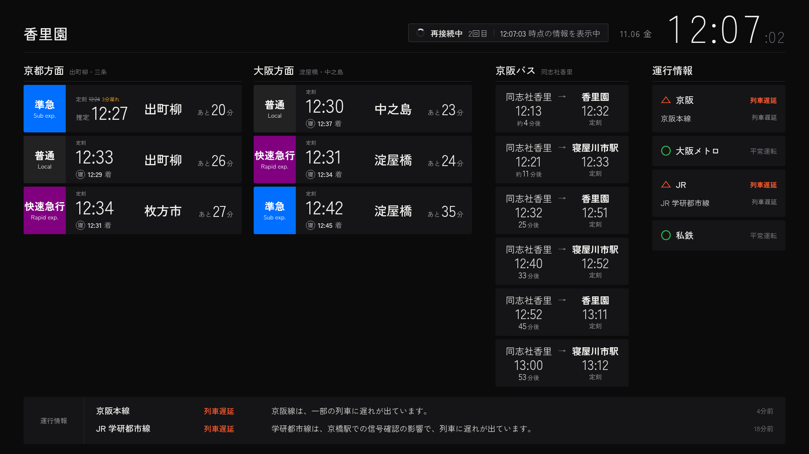

短い途切れでは、画面右上に「再接続中」と、何時何分の情報を表示しているかを出し、最後に取得した情報を表示し続けます。

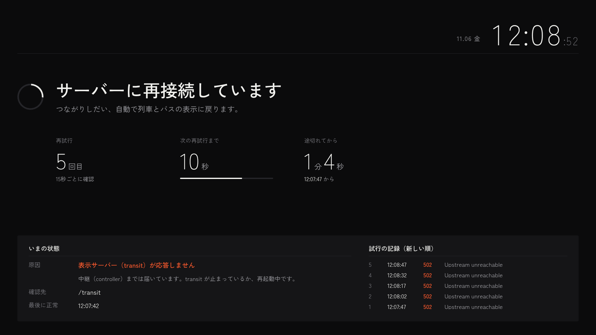

15秒ごとに接続を確認し、60秒間つながらなければ画面全体を上の再接続画面に切り替えます。
原因（端末のネットワーク、表示サーバーの停止など）と、試した記録を表示します。
つながれば自動で元の表示に戻ります。

## 6. 時計の表示と切り替えの予定

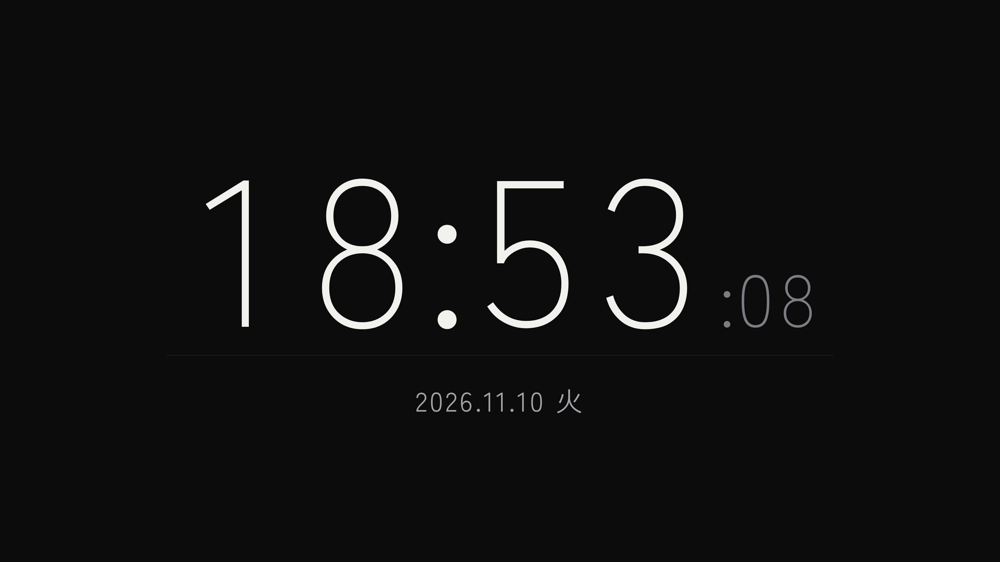

交通情報の代わりに、大きな時計を表示することもできます。どちらを表示するかは、時刻ごとの予定
（例：7時30分から交通情報、18時30分から時計）で自動的に切り替えます。
管理画面から手動で切り替えることもでき、その場合は指定した時間（標準は60分）だけ予定による切り替えを止めます。
管理画面（`/admin`）では、ほかに次のことができます。

- 端末に出ている画面と同じものを縮小して確認する
- 列車位置・バス・運行情報を最後に取得できた時刻と、取得の失敗を確認する。表示中の端末の台数も分かる
- 主な設定（表示する情報、駅、バス停、取得の間隔など）を変える

状況の確認はだれでもできます。表示の切り替えと設定の変更には、管理用のパスワードが必要です。

## 7. 個人情報と安全面

- サイネージは表示専用です。カメラ・マイク・入力装置は使わず、見ている人の情報は集めません。
- 取得するのは、京阪電車・京阪バス・鉄道各社が公式サイトで一般に公開している情報だけです。
- 遅延の分析と表示の改善のために、取得した公開情報（列車の位置・運行情報）をサーバーに保存しています。個人に関する情報は含みません。
- 運行情報は各社の公式サイトから取得します。運行情報の二次利用を禁止している Yahoo! 路線情報は使っていません。
- 各社の公式サイトには利用規約があり、情報の自動取得や二次利用に事業者の承認が必要とされている場合があります。
  このソフトウェアを使って情報を取得・表示するときは、取得先の利用規約を確認し、必要な承認を得てください。
- 表示内容や切り替えの予定を変更できるのは、管理用のパスワードを持つ物理部の管理者だけです。

## 8. 既知の制限

- 「推定」の時刻と「あと何分」は、公式の遅れの値を定刻に足し、遅れが10分以下なら残り時間に比例して割り引いただけの計算です。
  運転の再開時刻や、遅れの拡大は予測しません。
- 遅れの値は公式サイトの更新に合わせて変わるため、最大で約1分遅れて画面に反映されます。
  運行情報は10分ごとの取得なので、最大で約10分遅れます。
- 見合わせ時の画面への切り替えは、主に列車の位置から機械的に判定しています。鉄道会社が「運転見合わせ」を発表していなくても、
  多くの列車が止まっていれば切り替わります。反対に、発表があってもすぐには位置に表れないことがあります。
- 路線図と見合わせの判定の対象は、京阪本線（京橋〜樟葉）だけです。中之島線・交野線・宇治線は対象外です。
- 京阪電車の公式サイトが止まると、列車の情報は表示できません（2026年10月21〜22日に約22時間止まりました）。

## 9. システム構成

```
                  ┌────────────────────────────┐
  サイネージの端末 ─┤ controller（表示の切り替え）  │
  （ブラウザ）      └──────┬──────────┬────────┘
                          │          │
              ┌───────────┴──┐  ┌────┴─────┐
              │ transit       │  │ clock    │
              │（交通情報）     │  │（時計）   │
              └───────┬──────┘  └──────────┘
                      │ 1分〜10分ごとに取得
       京阪電車・京阪バス・鉄道各社の公式サイト
```

| 部品 | 役割 |
|---|---|
| controller | 端末に表示する画面（交通情報か時計か）を決め、予定に従って切り替える。接続の確認と再接続画面の表示も行う |
| transit | 公式サイトから情報を取得し、この章までに書いた判定を行って交通情報の画面を作る |
| clock | 時計の画面 |

3つとも Docker のコンテナとして物理部のサーバーで動いています。サイネージの端末はブラウザで画面を開くだけです。
画面は1920×1080を基準に作り、縦横比16:8〜16:10の画面に合わせて配置を調整します。

使っている主な技術は Python（FastAPI）、HTML/JavaScript、Docker です。
設定項目（基準の割合・分数など）、起動方法、テストの方法は [docs/DEVELOPMENT.md](docs/DEVELOPMENT.md) と
`config.yml.example` にあります。この文書に書いた数値は、すべて標準の設定値です。

## 10. デモ

サイネージの `/demo` で、本番の表示を変えずに次の場面を確認できます。

| デモ | 内容 |
|---|---|
| 停電時の運行記録 | 2026年10月30日に保存した京阪電車の列車位置を、当時の時刻に合わせて再生する |
| 通常運転 | 各社とも平常運転の場面（架空） |
| 大阪環状線で人立ち入り | JR大阪環状線などが運転見合わせ、京阪は平常運転の場面（架空） |
| 荒天で広域に影響 | 各社で運転見合わせ・遅延があり、京阪も大きく遅れている場面（架空） |
| 荒天で京阪も全面見合わせ | 京阪の全列車が止まっている場面（架空） |
| 列車カードの全表示パターン | 4.7 の表を、実際の描画処理で並べたもの |
| 起動イントロ | 画面の起動時の演出 |

この文書の画面の画像は、これらのデモと画面のテストから作りました。
